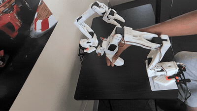

# SO-101 Sorting Cell

A real SO-101 color-sorting cell solved two ways, a classical pipeline (ArUco camera calibration, color detection and inverse kinematics) and a learned ACT policy trained from leader-arm demonstrations, compared on the same 50 trials.



Initial setup is done. The follower copies the leader, the overhead camera keeps a fixed focus and exposure, and the gripper's reachable box is in `config/workcell.yaml`. The comparison table will be filled from the sorting trials.

## Hardware

- SO-101 follower and leader. Robot ids are `follower_arm` and `leader_arm`.
- Logitech C930e overhead, 640×480 at 30 fps, camera name `front`.
- Lighting is an LED strip. Focus, exposure, gain, and white balance are locked by `scripts/00_camera_setup.sh` after every replug.

## Setup

```bash
conda env create -f environment.yml
# If the lerobot env already exists:
# conda env update -f environment.yml
conda activate lerobot
bash scripts/setup_env.sh
```

LeRobot itself is installed from source in `~/lerobot` at package version 0.6.2.

Give the arms stable names once, then replug them:

```bash
sudo cp udev/99-so101-arms.rules /etc/udev/rules.d/
sudo udevadm control --reload-rules
sudo udevadm trigger --subsystem-match=tty
```

```bash
export FOLLOWER=/dev/so101_follower
export LEADER=/dev/so101_leader
```

## Teleoperate

Run the camera lock first. The C930e forgets it on unplug.

```bash
bash scripts/00_camera_setup.sh
lerobot-teleoperate \
  --robot.type=so101_follower --robot.port=$FOLLOWER --robot.id=follower_arm \
  --robot.cameras="{ front: {type: opencv, index_or_path: /dev/v4l/by-id/usb-046d_Logitech_Webcam_C930e_C88D48BE-video-index0, width: 640, height: 480, fps: 30}}" \
  --teleop.type=so101_leader --teleop.port=$LEADER --teleop.id=leader_arm \
  --display_data=true
```

Ctrl+C stops the session. Rerun shows the `front` camera.
